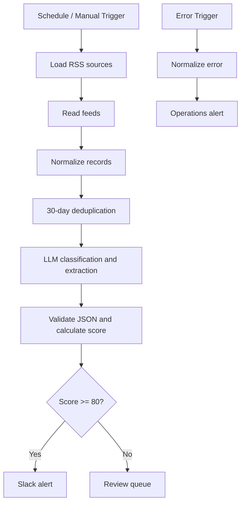

# AI Opportunity Intelligence Hub

An n8n automation project that discovers, enriches, scores, and routes startup opportunities such as grants, accelerators, competitions, events, and ecosystem updates.

## Workflow

## Included

- `workflows/01-opportunity-ingestion.json`: RSS ingestion, normalization, deduplication, LLM enrichment, weighted scoring and routing.
- `workflows/02-error-handler.json`: workflow failure notifications.
- `docs/`: architecture and scoring notes.
- `examples/`: sample opportunity records.

## Setup

1. Import the workflow JSON files into n8n.
2. Create a Header Auth credential for OpenAI with header `Authorization` and value `Bearer YOUR_OPENAI_API_KEY`.
3. Assign it to the AI analysis HTTP Request node.
4. Configure `SLACK_WEBHOOK_URL` in the n8n environment, or replace the Slack node.
5. Set the error-handler workflow in the ingestion workflow settings.
6. Verify RSS endpoints, run manually, inspect outputs, then activate the schedule.

No API keys are stored in this repository.

## Scoring

`score = round(0.50 * relevance + 0.30 * eligibility + 0.20 * credibility)`

- High (80-100): Slack alert
- Medium (60-79): review queue
- Low (0-59): review queue

Scores are triage signals, not eligibility decisions. Verify deadlines and requirements at the original source.

## Limitations and next steps

The example uses n8n workflow static data for deduplication and queueing. Replace it with PostgreSQL for durable multi-worker operation. Add retries, dead-letter handling, persistence, monitoring, and unit tests before production use. RSS endpoints can change and should be verified.

MIT License.
